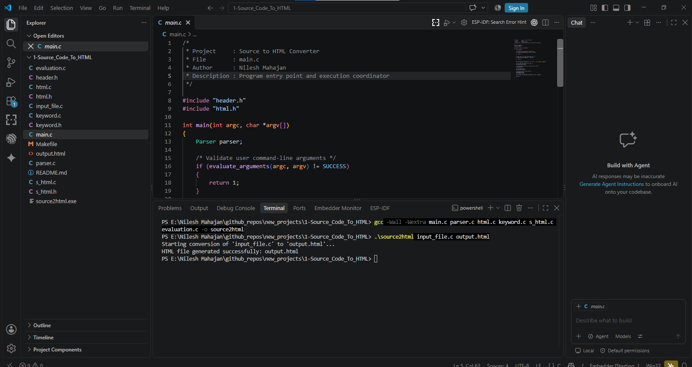
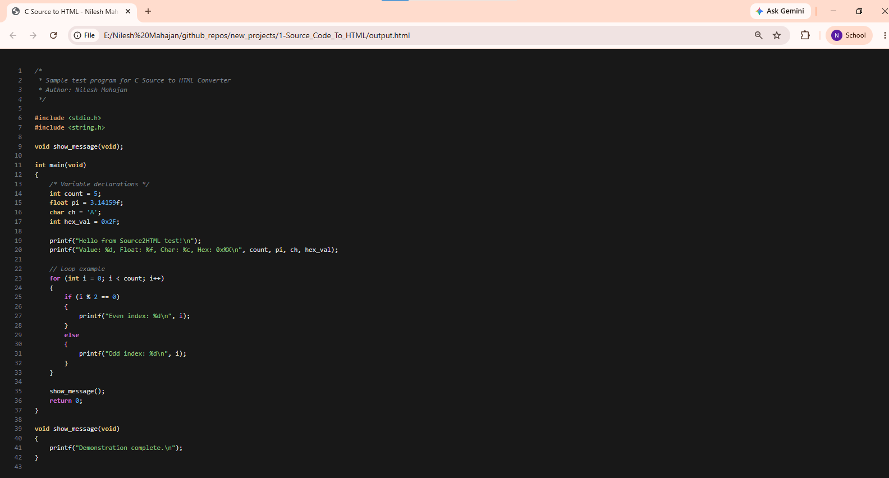

# C Source Code to HTML Converter

[](https://en.wikipedia.org/wiki/C_(programming_language))
[](https://en.wikipedia.org/wiki/C99)
[](LICENSE)

A modular, state-machine driven **C Source Code to Syntax-Highlighted HTML Converter** written in C. It parses C source programs, extracts tokens using lexical analysis, and generates a standalone, dark-themed HTML document with line numbering and customizable CSS syntax highlighting for keywords, preprocessors, headers, comments, literals, and operators.

---

## 📌 Features

- **Automated Syntax Classification**:
  - **Preprocessor Directives**: `#include`, `#define`, `#ifdef`, etc. (Highlighted in orange/bold)
  - **Header Files**: `<stdio.h>`, `"custom.h"` (Highlighted in green)
  - **Reserved Keywords**: `int`, `float`, `char`, `void`, `return`, `if`, `while`, etc. (Highlighted in yellow/purple)
  - **Comments**: Single-line (`//`) and multi-line (`/* ... */`) preserved with proper styling
  - **Constants & Literals**: Numeric constants, hex codes (`0xABCD`), string literals (`"..."`), and character constants (`'c'`)
- **Interactive Line Numbers**: Clean, non-selectable line number sidebar formatted in monospace.
- **Standalone CSS Theming**: Outputs a self-contained HTML file styled with modern dark-mode colors.

---

## 🏗️ Architecture & Modules

| File | Purpose |
| :--- | :--- |
| [`main.c`](main.c) | CLI argument validation, entry point, and high-level workflow orchestration |
| [`parser.c`](parser.c) | State machine for token scanning and character stream parsing |
| [`html.c`](html.c) / [`html.h`](html.h) | HTML/CSS wrapper generator (header styles, tags, line counter) |
| [`keyword.c`](keyword.c) / [`keyword.h`](keyword.h) | Lookup table and search logic for 32 standard C reserved keywords |
| [`evaluation.c`](evaluation.c) | Input and output filename validation |
| [`s_html.c`](s_html.c) / [`s_html.h`](s_html.h) | Specialized parser states for comments, strings, and operators |
| [`input_file.c`](input_file.c) | Sample test program demonstrating all token types |

---

## ⚙️ Build and Installation

### Prerequisites
- GCC Compiler (MinGW on Windows, GCC on Linux)
- Make (optional)

### Build with Make
```bash
# Compile project
make

# Run on sample input file
make run

# Clean build artifacts
make clean
```

### Manual Compilation
```bash
gcc -Wall -Wextra main.c parser.c html.c keyword.c s_html.c evaluation.c -o source2html
./source2html input_file.c output.html
```

---

## 📸 Terminal Execution & Output

### 1. VS Code Terminal Compilation and Run:


### 2. Generated Syntax-Highlighted HTML Output:


---

## 👤 Author

**Nilesh Mahajan**  
- **GitHub**: [@Nileshkm911](https://github.com/Nileshkm911)
- **LinkedIn**: [Nilesh Mahajan](https://linkedin.com/in/nilesh-mahajan-150a1b2a5)
